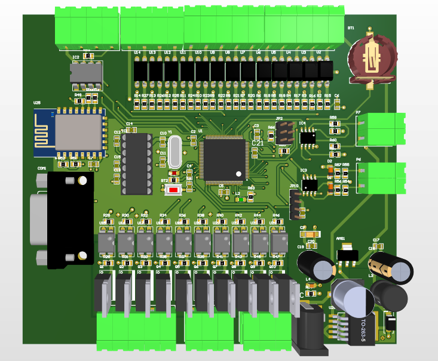
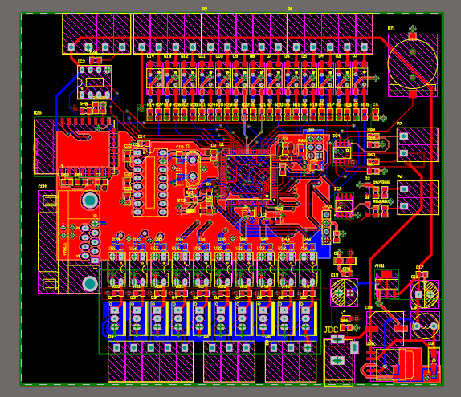

# Controller Board - STM32 Industrial & IoT Control System

Bo mạch điều khiển trung tâm đa năng kết hợp chuẩn giao tiếp công nghiệp (RS232/RS485) và kết nối không dây IoT (ESP8266), hỗ trợ các cổng vào/ra Analog và Digital.

---

## 📸 Hình ảnh mạch (PCB Preview)

### Phối cảnh 3D (3D View)


### Sơ đồ thiết kế PCB 2D (Top & Bottom Layout)


---

## 🛠 Thông số kỹ thuật & Tín hiệu (Specifications)

* **Vi điều khiển trung tâm (MCU):** STM32F100xx (Chân LQFP100)
  * Thạch anh ngoại: 16 MHz
  * Giao diện nạp/nạp lỗi: SWD (SWDIO, SWCLK)
  * Nguồn pin CMOS dự phòng: CR1220 SMD
* **Mô-đun không dây (IoT):** ESP8266-12 (Giao tiếp UART với STM32)
* **Giao tiếp truyền thông công nghiệp:**
  * Khối RS232
  * Khối RS485
* **Khối Vào/Ra (I/O Blocks):**
  * **Digital Input (D_Input):** Hỗ trợ cách ly/đệm tín hiệu số vào
  * **Digital Output (D_Output):** Tín hiệu số đầu ra điều khiển tải
  * **Analog Input (A_Input):** Đọc cảm biến Analog
  * **Analog Output (A_Output):** Xuất tín hiệu Analog
* **Khối nguồn (Regulator):** Hạ áp & ổn định điện áp 3.3V cung cấp cho toàn mạch

---

## 📂 Cấu trúc thư mục dự án (Project Structure)

Dự án được thiết kế theo dạng **Hierarchical Schematic** (Sơ đồ nguyên lý phân cấp) trong Altium Designer:

```text
Controller_board/
├── Controller_board.PrjPcb     # File quản lý dự án Altium
├── Mach_IO.PcbDoc             # File thiết kế mạch in PCB
├── Mach_IO.SchDoc             # Sheet tổng (Top-Level Schematic)
├── D_Input.SchDoc             # Sơ đồ khối Digital Input
├── D_output.SchDoc            # Sơ đồ khối Digital Output
├── A_Input.SchDoc             # Sơ đồ khối Analog Input
├── A_output.SchDoc            # Sơ đồ khối Analog Output
├── RS232.SchDoc               # Sơ đồ khối truyền thông RS232
├── RS485.SchDoc               # Sơ đồ khối truyền thông RS485
├── esp8266.SchDoc             # Sơ đồ khối mô-đun WiFi ESP8266
├── Regulator.SchDoc           # Sơ đồ khối quản lý nguồn
├── images/                    # Thư mục chứa hình ảnh xem trước
│   ├── pcb_2d.png
│   └── pcb_3d.png
└── README.md                  # Tài liệu hướng dẫn dự án
```

---

## 🚀 Hướng dẫn mở dự án

1. Cài đặt phần mềm **Altium Designer** (khuyến nghị phiên bản 20.0 trở lên).
2. Tải hoặc `git clone` repository này về máy.
3. Mở file `Controller_board.PrjPcb`.
4. Mở `Mach_IO.SchDoc` để xem sơ đồ nguyên lý tổng hoặc `Mach_IO.PcbDoc` để xem sơ đồ lớp mạch in PCB.